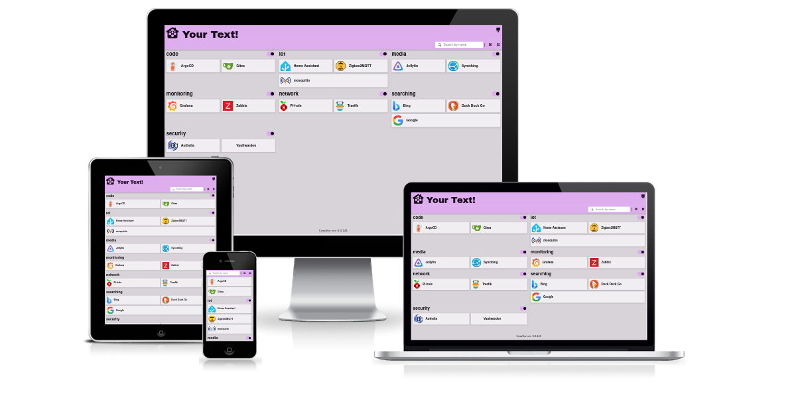
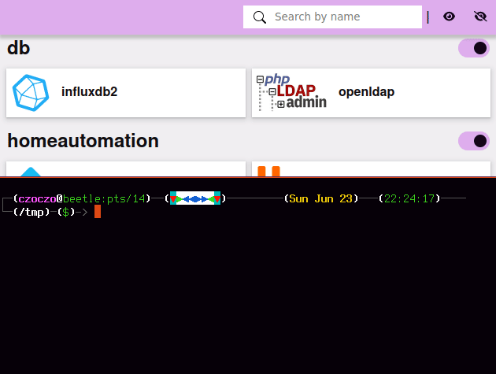

> Customizable progressive web application for dynamic indexing of Kubernetes Ingress resources.

## Objectives
CasaVue aims to:  
- 🎨 Enable simple yet powerful theme customization.  
- 👌Be a perfect choice for Kubernetes hosted applications index page.  
- 📱 Provide great experience on all devices / native app feeling on mobiles.  
- ☔ Hide complexity, to provide simple configuration options.  
- 🤏 Have small multiarch (x86 + Arm64) container images.  

## Preview

## Demo
A view of what CasaVue deployment might look like running on home lab K8s:

<a href="https://demo.casavue.app">https://demo.casavue.app</a>

## Intrigued?
A couple of options:
- Read about the [features](https://casavue.app/about/features/) of CasaVue.
- Having access to running K8s? Try [quick install](https://casavue.app/deployment/quick_start/).
- Further explore project [home page](https://casavue.app).

## :bar_chart: Star History

<a href="https://www.star-history.com/?type=date&repos=czoczo%2Fcasavue">
 <picture>
   <source media="(prefers-color-scheme: dark)" srcset="https://api.star-history.com/chart?repos=czoczo/casavue&type=date&theme=dark&legend=top-left" />
   <source media="(prefers-color-scheme: light)" srcset="https://api.star-history.com/chart?repos=czoczo/casavue&type=date&legend=top-left" />
   
 </picture>
</a>

## License

GNU General Public License v3.0 or later

See [LICENSE](LICENSE) to see the full text.
