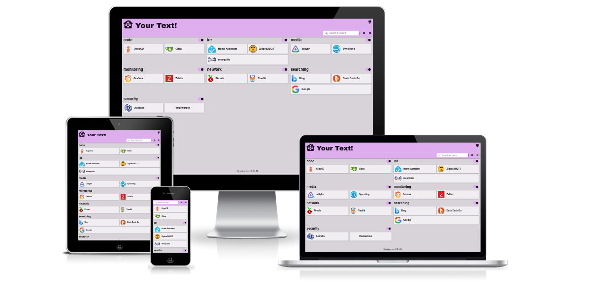
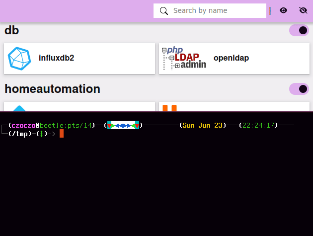

import { Card, CardGrid } from '@astrojs/starlight/components';

</img>

 
<CardGrid stagger>
	<Card title="Works out of the box!" icon="rocket">
		Default config is fully functional. All you need is running K8s. Read [quick start](/deployment/quick_start/) to get going.
	</Card>
	<Card title="Customization" icon="setting">
	        Customize the theme's colors using the live preview. The app even lets you change the logo and header for complete personalization!
	</Card>
	<Card title="Advanced icon search!" icon="add-document">
                Tired of setting app icons on dashboard? No problem, CasaVue will try to match icons to displayed services. If it fails, a unique avatar is generated. 
	</Card>
	<Card title="Look and feel" icon="pencil">
		No time to go through quick start? See [DEMO](https://demo.casavue.app) of what CasaVue deployment might look like running on home lab K8s or [this repository](https://github.com/czoczo/casavue-demo), to see how such page is created.
	</Card>
</CardGrid>

</img>
